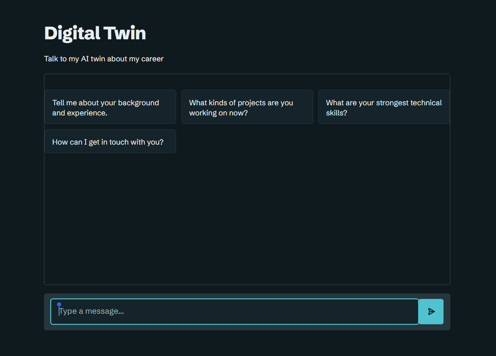
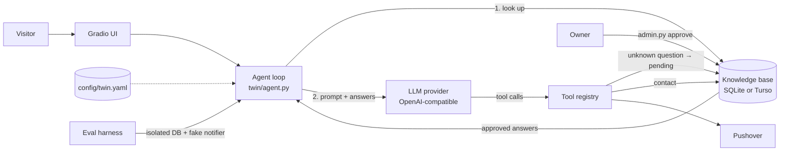

# Digital Twin

An AI "digital twin" that represents me to recruiters and hiring managers on my website. It answers questions about my career from my CV, captures contact requests, and gets better over time through a human-approved knowledge base. Its quality is measured by an evaluation suite.

It's built **without an agent framework**, so every part of the loop is visible and testable. Everything specific to me lives in one config file, so the same code can run a business assistant by swapping that file.

**Live demo:** https://digital-twin-8faq.onrender.com

**Built with:** Python, Gradio, the OpenAI API (or any compatible provider), SQLite with FTS5, Turso, Pushover, pytest



## Architecture



| Path | Responsibility |
|---|---|
| `app.py` | Gradio chat page; all visible text and colours come from the config |
| `styles.py` | Page styling, with colours that the config can override |
| `config/twin.yaml` | Persona, knowledge sources, privacy redaction, model, tools, UI branding, eval settings |
| `config/business_template.yaml` | The same system configured as an imaginary physio clinic's assistant |
| `company_docs/` | The clinic's made-up sample documents |
| `twin/config.py` | Typed, validated config loading (unknown keys fail fast) |
| `twin/llm.py` | Provider abstraction: any OpenAI-compatible endpoint (OpenAI, OpenRouter, Ollama, Gemini…) |
| `twin/context.py` | Builds the system prompt; scrubs phone numbers and third-party emails from source docs |
| `twin/knowledge.py` | Store for approved Q&A (full-text search), pending questions, contacts and the interaction log |
| `twin/turso.py` | Connects the same store to a hosted Turso database over its HTTP API |
| `twin/tools.py` | Decorator-based tool registry; config picks which tools are offered |
| `twin/notifications.py` | Owner alerts through Pushover, or none |
| `twin/agent.py` | Retrieval → bounded tool loop → trace; never crashes the chat |
| `admin.py` | Owner's review console for the approval workflow |
| `evals/` | Evaluation dataset, deterministic checks, LLM-as-judge, regression gate |
| `testing/` | Unit tests, using scripted model replies and sample documents |
| `v1/` | The earlier version of the twin, kept for reference |

## 1. Config-driven design

All deployment choices are in `config/twin.yaml`. `config/business_template.yaml` shows the same system as an imaginary physio clinic's assistant with a different persona, documents, colours and database, and no code changes.

To switch model provider, change `llm.base_url` and `llm.model`. To add a tool, decorate a function with `@tool(...)` in `twin/tools.py` and list its name under `tools.enabled`.

## 2. Curated knowledge base (human-in-the-loop)

RAG retrieves *fuzzy* matches from documents. This layer stores *exact, owner-approved* answers. That suits facts where a wrong answer has consequences, such as salary expectations, notice period or relocation.

**Read path.** Each message is matched against approved Q&A pairs. FTS5 full-text search finds candidates and a similarity score re-ranks them. Matches above `match_threshold` are given to the model as authoritative answers, and each use is counted.

**Write path.** When the twin can't answer, `record_unknown_question` stores the question as `pending`, de-duplicates repeats, counts how often it's asked, and sends a Pushover notification.

**Review loop:**

```bash
uv run python admin.py pending                      # most-asked unanswered questions first
uv run python admin.py approve 7 "Yes - I'm open to relocating anywhere in South Africa."
uv run python admin.py search "would you relocate"  # check what the twin will now retrieve
uv run python admin.py export                       # write approved answers to data/approved_answers.yaml
uv run python admin.py stats                        # KB hit rate, pending count, contacts, round-cap hits
```

## 3. Evaluation harness

`evals/dataset.yaml` holds 23 cases across 8 categories: grounded facts, unknown questions, contact capture, off-topic requests, personal-life questions, security (prompt extraction, phone and referee leaks, AI disclosure), knowledge-base retrieval, and multi-turn context.

Each case is scored in two layers:
1. **Deterministic checks.** These cover required and forbidden phrases, regexes, which tools were or weren't called with which arguments, whether the knowledge base was hit, and whether the tool loop hit its cap.
2. **LLM-as-judge.** A 1 to 5 score against a per-category rubric, using the reference documents as ground truth. Any fabrication caps the score at 2.

**Current results:** all 23 cases pass, with an average judge score above 4.9 out of 5.

```bash
uv run python -m evals.run_evals --no-judge           # checks only: fast and cheap
uv run python -m evals.run_evals                      # checks + judge
uv run python -m evals.run_evals --repeats 3          # measure flakiness
uv run python -m evals.run_evals --save-baseline      # record current quality
uv run python -m evals.run_evals --baseline evals/baseline.json   # exit 1 if any category regressed
```

Every run uses an in-memory database seeded with fixtures and a no-op notifier, so evals never touch real data or send notifications. Reports are written to `evals/results/` as Markdown and JSON.

**Workflow:** change the prompt, config or model → run the evals → compare against the baseline → merge only if nothing regressed.

## Running locally

The documents behind my own twin (`summary.txt`, `project_facts.txt`, `project_readmes.txt` and a CV PDF) are private and not in this repository, so `config/twin.yaml` won't start from a fresh clone. Use the clinic template instead, which includes made-up sample documents, or point `knowledge_sources` in `config/twin.yaml` at your own documents.

Install the dependencies, then create a `.env` file containing `OPENAI_API_KEY`:

```bash
uv sync
```

Run the clinic template in Bash:

```bash
TWIN_CONFIG=config/business_template.yaml uv run python app.py
```

Or in PowerShell:

```powershell
$env:TWIN_CONFIG = "config/business_template.yaml"; uv run python app.py
```

Run the unit tests, which need no API key or private documents:

```bash
uv run pytest -q
```

The evals use the real model and read the real documents, so they need an API key, and running them on `config/twin.yaml` also needs those documents.

## Deployment

The live site runs on Render, using `pip install -r requirements.txt` to build and `python app.py` to start. Deploy from a private source that includes your documents, because `.gitignore` keeps them out of this repository.

| Environment variable | Purpose |
|---|---|
| `OPENAI_API_KEY` | The model provider's API key |
| `PUSHOVER_USER`, `PUSHOVER_TOKEN` | Alerts for new contacts and unanswered questions |
| `GRADIO_SERVER_NAME` | Set to `0.0.0.0`, so the host can reach the app |
| `GRADIO_SERVER_PORT` | The port the host expects (`10000` by default on Render) |
| `TURSO_DATABASE_URL`, `TURSO_AUTH_TOKEN` | The hosted database |

**Why Turso:** Render's free tier wipes the disk on every deploy, so the live site keeps its data in a hosted [Turso](https://turso.tech) database. Create a libSQL database (not `--tursodb`, whose engine lacks the FTS5 search used here). With both Turso variables set, the app and `admin.py` use Turso; without them, they use the local `data/twin.db`. So with these in your local `.env`, `admin.py` works on live data, and running `app.py` locally writes to it too.

`admin.py export` still writes approved answers to a YAML file you can commit as a backup, and it's loaded at startup.

## Safety and robustness

- **Personal life.** The twin declines questions about my private life, even when the details appear in its documents, and the evals test this.
- **Contact capture.** The twin can only record an email address the visitor actually wrote, so it can't save an invented one.
- **Bounded tool loop.** The loop is capped at `max_tool_rounds`; at the cap the model is forced to give a text answer.
- **Redaction.** Phone numbers in any spacing and referees' emails are removed from source documents before they reach the model, so they can't be leaked.
- **Confidential instructions.** The prompt treats its own instructions as confidential, and the evals test this.
- **Failure handling.** If the LLM provider, Pushover or the database fails, the visitor still gets a reply rather than an error page.
- **Bounded history.** Conversation history is sanitised and trimmed.
- **Interaction logging.** Each exchange is logged with tools used, knowledge-base matches and latency. This can be turned off with `log_interactions`.

## Licence

MIT. See [LICENSE](LICENSE).
